<div align="center">


<p>
  <b>Glide a woven carpet over endless procedural dunes.</b><br>
  A tiny 3D browser game, built as one self-contained HTML file, with an Amazigh art direction.
</p>

<p>
  
  
  
  
  
</p>

<p>
  <a href="#play"><b>Play</b></a> &nbsp;◆&nbsp;
  <a href="#levels">Levels</a> &nbsp;◆&nbsp;
  <a href="#controls">Controls</a> &nbsp;◆&nbsp;
  <a href="#how-it-works">How it works</a> &nbsp;◆&nbsp;
  <a href="#development">Development</a> &nbsp;◆&nbsp;
  <a href="#credits">Credits</a>
</p>

</div>

<table>
  <tr>
    <td width="50%" align="center">
      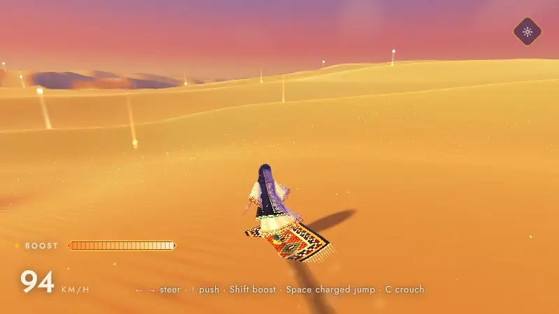<br>
      <sub><b>Free dunes</b>: carve, boost, jump. The letters are Tifinagh, thrown off by the boost.</sub>
    </td>
    <td width="50%" align="center">
      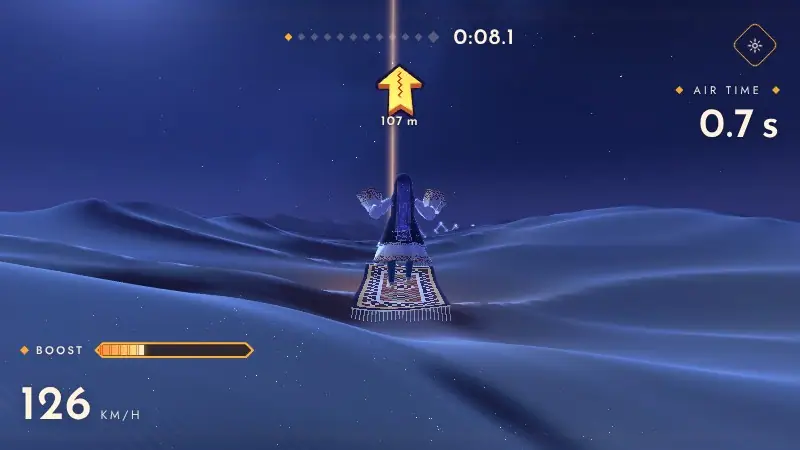<br>
      <sub><b>Tiziri</b>: a night course of twelve gates of light.</sub>
    </td>
  </tr>
</table>

SandWake is about one feeling: sliding on sand at the end of the day. You ride a woven carpet as a veiled rider from the
Souss, push downhill, charge a jump off a crest, boost through the air and land in a spray of sand, while the light
turns from amber to indigo. There is no engine, no framework and no asset pipeline: the dunes, the sky, the rider, the
particles and even the music are generated by code.

> **Azul** (ⴰⵣⵓⵍ), "hello" in Tamazight. The interface speaks French, English, Chinese, Russian and Amazigh, written in
> Tifinagh.

<p align="center"></p>

## Play

The game is a single HTML file. Build it once, then open it in any modern browser with WebGL:

```sh
git clone <this repository>
cd sandwake
npm install
npm run build          # writes dist/index.html
```

Open `dist/index.html` directly, or serve the folder:

```sh
python3 -m http.server --directory dist 8080    # then visit http://localhost:8080
```

three.js (r128) and the Google Fonts are loaded from CDNs, so the first load needs an internet connection. Without the
fonts the game falls back to system fonts; three.js is required to play. To host it, copy `dist/index.html` to any
static host. The repository also ships a manual GitHub Pages workflow (see [Deploy](#deploy)).

<details>
<summary><b>Nothing shows up, or it runs slowly?</b></summary>

- **"WebGL is not available"**: enable hardware acceleration in the browser settings. The game needs WebGL to draw the
  dunes.
- **Low frame rate**: open the settings panel (the gear, top right) and pick **Low** or **Medium**. In **Auto** the render
  resolution scales between 50 % and 100 % to keep the frame rate near 60 fps, and the preset steps down if the device keeps struggling.
- **No sound**: browsers only start audio after a first interaction. Press `M` to toggle the sound.
- **Different fonts**: the display fonts come from Google Fonts. Offline, the game uses system fonts and the layout still
  holds.

</details>

<p align="center"></p>

## Levels

<table>
  <tr>
    <td width="56%" valign="top">
      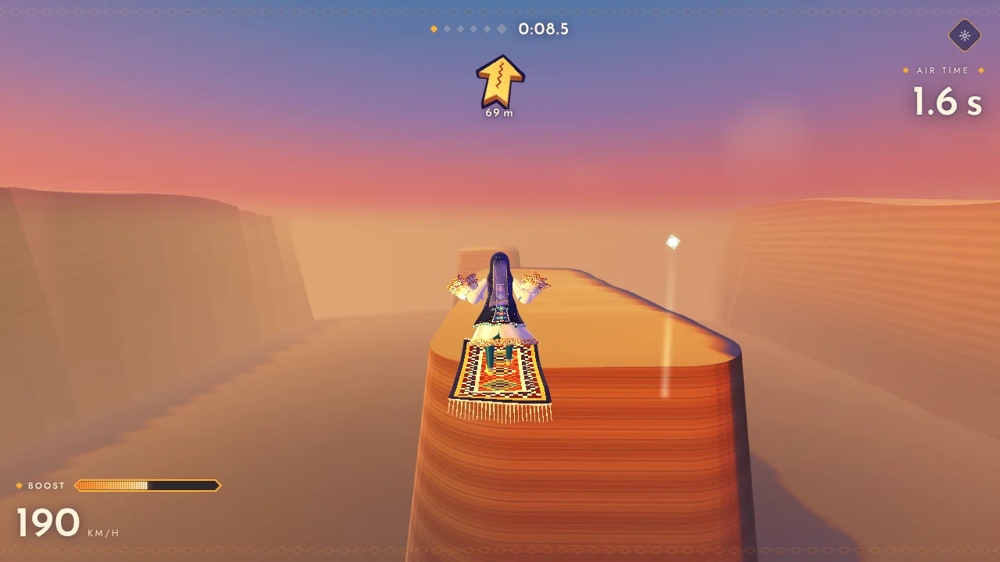
    </td>
    <td valign="top">
      <h3>Level 1 · Jbel</h3>
      <p><i>The mountain.</i> A bottomless canyon and five pillars of red rock, with gaps of 130 to 200 metres between them.
      Build speed on the start cliff, hold <kbd>Space</kbd> to charge a jump, release at the edge of the pillar and
      steer your flight with the boost.</p>
      <p>Reach the <b>golden star</b> on the last pillar. A 3D arrow at the top of the screen points at the next target. A
      fall costs nothing but time: you are put back on the last pillar you reached, with your momentum.</p>
    </td>
  </tr>
  <tr>
    <td width="56%" valign="top">
      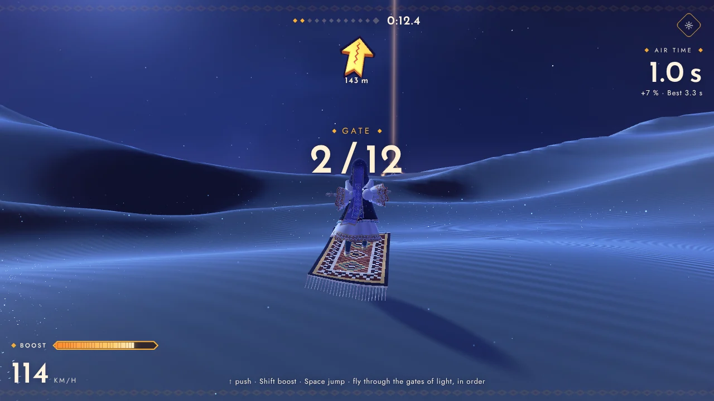
      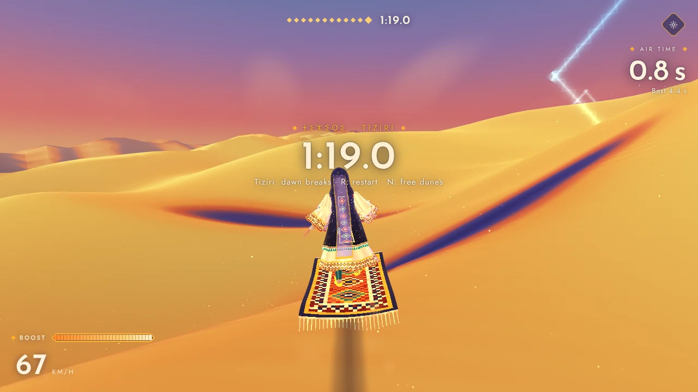
    </td>
    <td valign="top">
      <h3>Level 2 · Tiziri</h3>
      <p><i>Moonlight.</i> A starry night over a sea of taller dunes. Twelve lozenge gates of light are strewn along the
      course: fly through them in order, skimming the sand or in mid-air. Miss one and the game tells you to turn around; the arrow keeps pointing at it.</p>
      <p>The last gate is golden. Cross it and the <b>dawn breaks</b>: the sky, the sand, the rider and every effect blend
      from night to sunrise.</p>
    </td>
  </tr>
  <tr>
    <td width="56%" valign="top">
      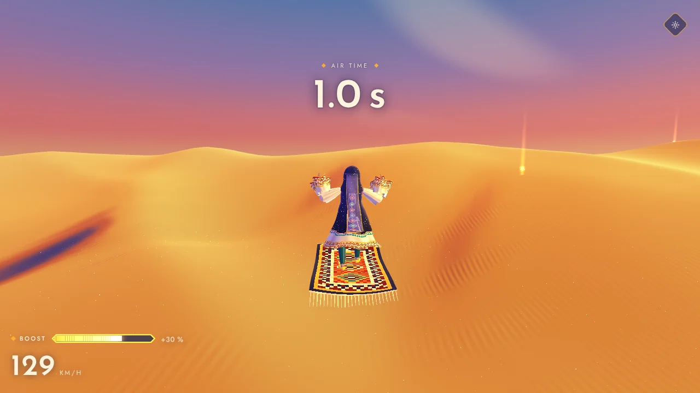
    </td>
    <td valign="top">
      <h3>Free dunes</h3>
      <p>No goal, just the carpet, the wind and the light. The dunes never end, and star orbs are scattered over them to
      refill the boost (the turquoise ones float high; catch them in the air for a bigger refill).</p>
      <p>Air time, flips and landings are scored: a clean landing, a rough one, a new record. Press <kbd>N</kbd> after a
      course to move on to the next level.</p>
    </td>
  </tr>
</table>

<p align="center"></p>

## Controls

| Key                                                   | Action                                                                    |
| ----------------------------------------------------- | ------------------------------------------------------------------------- |
| <kbd>←</kbd> <kbd>→</kbd> / <kbd>A</kbd> <kbd>D</kbd> | Steer                                                                     |
| <kbd>↑</kbd> / <kbd>W</kbd>                           | Push to build speed                                                       |
| <kbd>↓</kbd> / <kbd>S</kbd>                           | Brake                                                                     |
| <kbd>Shift</kbd>                                      | **Boost**: recharges over time, and steers your flight in the air         |
| <kbd>Space</kbd>                                      | **Jump**: hold to charge, release to launch. Tap again in the air to flip |
| <kbd>Space</kbd> + <kbd>↓</kbd>                       | Backflip, in the air                                                      |
| <kbd>C</kbd>                                          | Crouch (faster downhill); dive while boosting in the air                  |
| <kbd>R</kbd>                                          | Restart the level                                                         |
| <kbd>N</kbd>                                          | Next level, once the current one is finished                              |
| <kbd>H</kbd> / <kbd>M</kbd>                           | Hide or show the interface · sound on or off                              |

<table>
  <tr>
    <td valign="top">
      <h4>On a phone</h4>
      <p>A joystick on the left steers, pushes and brakes. Three diamond buttons on the right jump, boost and crouch. The
      quality starts one notch lower on touch screens, and adapts from there.</p>
    </td>
    <td width="26%" align="center">
      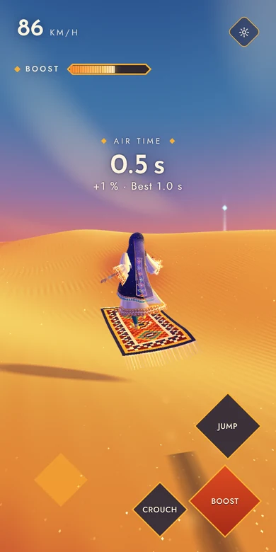
    </td>
  </tr>
</table>

<p align="center"></p>

## Languages

The language follows the browser and can be changed in the settings panel. Everything is translated, including the
in-game labels and the accessibility texts.

<p align="center">
  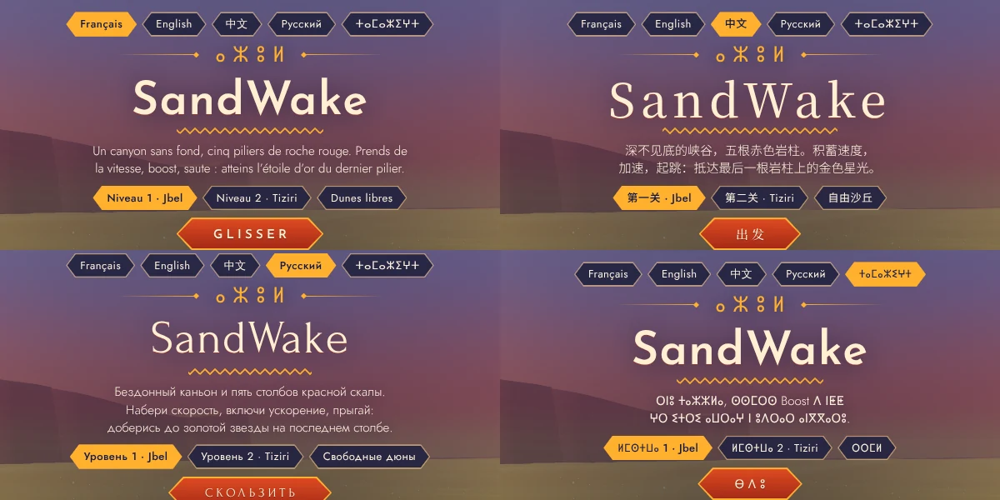
</p>

| Code  | Language                               | Note                                                                                   |
| ----- | -------------------------------------- | -------------------------------------------------------------------------------------- |
| `fr`  | Français                               |                                                                                        |
| `en`  | English                                | Fallback for any missing string                                                        |
| `zh`  | 中文                                   |                                                                                        |
| `ru`  | Русский                                |                                                                                        |
| `zgh` | ⵜⴰⵎⴰⵣⵉⵖⵜ (Standard Moroccan Tamazight) | Written in Tifinagh. Also selected for the browser codes `tzm`, `shi`, `rif` and `ber` |

The Amazigh translation is a first draft and benefits from a native review: corrections are very welcome (see
[Adding a language](#adding-a-language)).

<p align="center"></p>

## How it works

SandWake has no dependency apart from three.js, and uses it mostly as a thin layer over WebGL: the interesting parts are
hand-written shaders and a small amount of math.

### A world defined by a formula

There is no heightmap and no texture. The ground is a closed-form height field: a sum of six phase-modulated
waves, from large swells to fine ripples. Each component $i$ bends its crest line, skews it into a steep lee face and
varies its height from one dune to the next:

$$
\theta_i = \mathbf{k}_i \cdot \mathbf{p} + \varphi_i + w_i \sin(\mathbf{q}_i \cdot \mathbf{p} + \psi_i), \qquad
\theta_i' = \theta_i + s_i \sin\theta_i
$$

$$
f_i = (1 - r_i)\,\sin\theta_i' + r_i \left(0.64 - \sqrt{\sin^2\theta_i' + \sigma_i}\right), \qquad
E_i = 1 - \tfrac{d_i}{2}\bigl(1 - \sin(\mathbf{m}_i \cdot \mathbf{p} + \chi_i)\bigr)
$$

$$
h(\mathbf{p}) = A \sum_{i=1}^{6} a_i \, E_i(\mathbf{p}) \, f_i(\mathbf{p})
$$

The same formula is evaluated twice: on the CPU in [`src/sim.js`](src/sim.js) for the physics, the camera and the
particles, and on the GPU in [`src/shaders.js`](src/shaders.js) for rendering. The carpet therefore never floats above
the sand nor sinks into it, and the gradient (needed for the slope under the rider) comes for free.

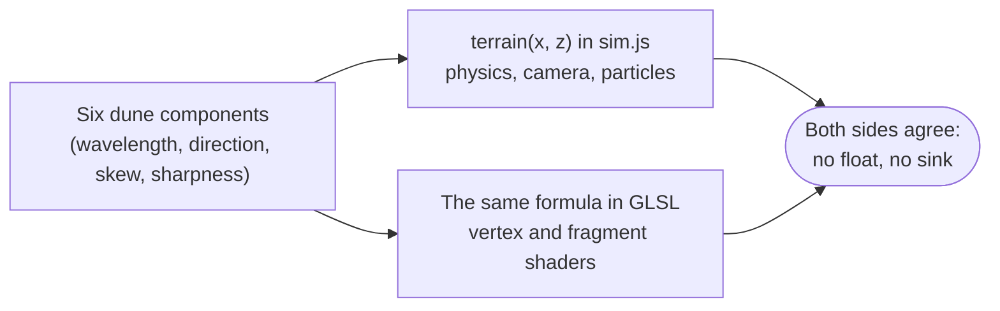

The Jbel level is one more analytic field on top of the dunes: rounded boxes whose edges drop into the void, with the
same signed-distance formula in JavaScript and in GLSL.

### An unbounded world, in single precision

Positions live in double precision on the CPU. What reaches the GPU is relative to a **floating origin** that is
re-centred whenever the rider drifts too far from it, and the wave phases at the origin are computed on the CPU in
double precision. Far from the start, nothing jitters and nothing is lost to the 32-bit floats of the shaders.

Star orbs follow the same idea: the world is a grid of 46 m cells, each of which holds an orb or not according to a hash
of its coordinates. Nothing is stored except the list of orbs you collected, which come back after 80 seconds.

### One frame

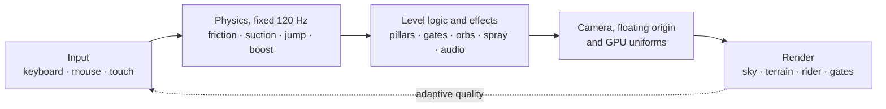

### The feel

The carpet is a point on a surface with a handful of forces. The numbers below are the real ones, from
[`src/sim.js`](src/sim.js):

| Parameter                   | Value             | Effect                                                                       |
| --------------------------- | ----------------- | ---------------------------------------------------------------------------- |
| Gravity                     | 11 m/s²           | A floaty arc: jumps feel long                                                |
| Jump                        | 6.5 to 13.5 m/s   | Tap for a hop, hold 0.55 s for the full charge                               |
| Speed cap                   | 70 m/s (252 km/h) | Soft cap; the boost raises it by 40 %                                        |
| Boost                       | 0.24 gauge per s  | Full gauge lasts about 4 s; refills slowly after 1.4 s of rest, or with orbs |
| Ground suction              | 14 m/s²           | The carpet sticks to small bumps and lets go on real crests                  |
| Mid-air steering with boost | steerable thrust  | The trajectory turns towards the heading, so the flight can be aimed         |

### Night, dawn and the shaders

Tiziri blends a night palette into the sky, the sand, the rider and the particles through a single `uNight` uniform, so
the dawn is one number going from 1 to 0. The twelve gates are drawn in **one draw call**: nine camera-facing ribbon
quads per gate (the lozenge, its inner target and a beam), whose state arrives through two uniform arrays. The rider's
skirt and sleeves, and the start flag of Jbel, are cloth animated in the vertex shader.

### Music from nothing

There is not a single audio file. The score is synthesised with Web Audio and inspired by the Ahwash and the Rways of
the Souss: a **12-beat pulse** (4 × 3), a pentatonic mode on D with a minor second as colour, and five voices:
_bendir_ (frame drum with buzzing snares), _naqus_ (small metals), _lotar_ (plucked lute), _rebab_ (bowed fiddle with
glides) and an "aah" choir in fifths. The game drives the arrangement: the tempo follows your speed, the drums come in
when you move, the lute when you run fast and the choir when you boost. At night the music slows down.

### Quality and performance

| Preset | Terrain mesh (rings × segments) | Dust particles | Sand glitter and ripples | Sun-shadow steps | Max pixel ratio |
| ------ | ------------------------------- | -------------- | ------------------------ | ---------------- | --------------- |
| Low    | 90 × 96                         | 700            | off                      | 3                | 1.0             |
| Medium | 120 × 132                       | 2 000          | on                       | 5                | 1.25            |
| High   | 150 × 170                       | 4 200          | on                       | 6                | 1.75            |

The terrain is a single polar mesh with logarithmically spaced rings, dense around the rider and stretching to the
horizon; the heights come from the vertex shader. In **Auto**, the render resolution scales between 50 % and 100 % to
keep the frame rate near 60 fps, and the preset steps down from High to Medium to Low if the device keeps struggling.

<p align="center"></p>

## Development

You need Node.js 20.19+, 22.13+ or 24+ for the development tools (the build script itself runs on Node 18 or later).

```sh
npm install
npm run build        # bundle everything into dist/index.html
npm run check        # formatting, lint (sources and bundle), unit tests and a build
npm test             # unit tests only (node:test, no browser needed)
npm run test:e2e     # end-to-end tests in headless Chromium
npm run format       # apply Prettier
```

The end-to-end tests drive the built game through the `window.__sandwake` debug handle. They need a Chromium build for
Playwright (`npx playwright install chromium`) and a previous `npm run build`. WebGL runs in software (SwiftShader), so
no GPU is required, but the tests are slow. They check every language, the three levels, a fall into the canyon, and an
autopilot that flies through the twelve gates of Tiziri until the dawn breaks.

### Project layout

```
src/
  sim.js           Analytic terrain, level data and carpet physics (no dependencies).
  shaders.js       GLSL sources: terrain, sky, rider, particles, gates.
  avatar.js        The procedural rider and carpet: geometry, materials, animation.
  music.js         Generative music: pentatonic modes, drums, a night variant.
  i18n.js          Interface strings for every language, and the language picker.
  game/            The game itself, split by concern (see game/01-runtime.js).
  styles.css       Interface styles.
  template.html    Page skeleton with the interface markup.
assets/            The Tifinagh font subset embedded in the build, and its licence.
docs/              The banner, the divider and the screenshots of this README.
scripts/           build.js (bundler) and lint-bundle.js (lints the bundle).
tests/unit/        Unit tests: physics, terrain, levels, translations, build.
tests/e2e/         Browser tests: languages, levels, the Tiziri autopilot, settings.
```

The sources are plain browser scripts rather than ES modules. `scripts/build.js` concatenates `sim.js`, `shaders.js`,
`avatar.js`, `music.js` and `i18n.js`, then wraps `src/game/*.js` (in file-name order) in one function scope, and inlines
the result, the stylesheet and the font into `template.html`. Files therefore share their top-level names, and the
numeric prefixes of `src/game` give the initialisation order.

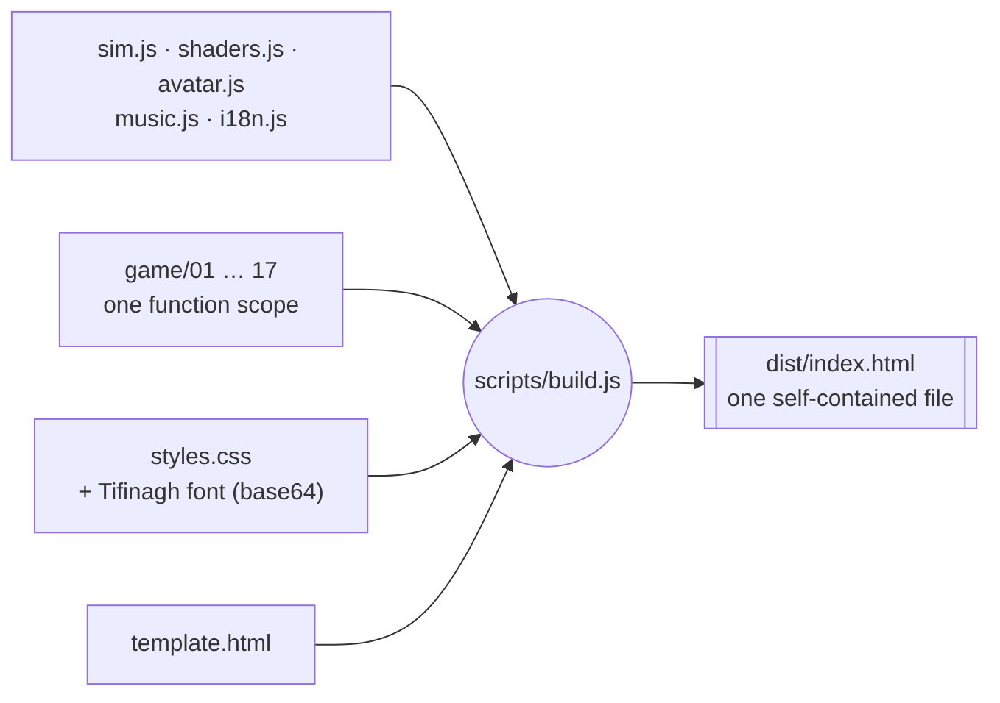

### Adding a language

1. Add a block to `I18N` in `src/i18n.js` with exactly the keys of the English one (`npm test` checks this) and list the
   code in `LANGS`.
2. Add a button with `data-l="<code>"` to both `.langs` groups in `src/template.html`.
3. If the script needs a particular font, add an `html[lang="<code>"]` rule in `src/styles.css`.

### Deploy

`.github/workflows/pages.yml` builds the game and publishes it to GitHub Pages. It runs only when you start it by hand
(**Actions → Deploy to GitHub Pages → Run workflow**), after enabling **Settings → Pages → Source: GitHub Actions**.

<p align="center"></p>

## Credits

Made by **Sacripant**. Inspired by Amazigh art from the Souss: the zigzags and lozenges of the woven borders, the
Tifinagh script, the carpets and the music of the region. Any mistake in how these are rendered or translated is mine,
and corrections from people who know this heritage better are welcome.

See [THIRD_PARTY_NOTICES.md](THIRD_PARTY_NOTICES.md) for the fonts and libraries used: three.js, Noto Sans Tifinagh,
Reem Kufi, Forum, Jost and Noto Serif SC.

<p align="center">
  <sub>ⴰⵣⵓⵍ · Glide well.</sub>
</p>
